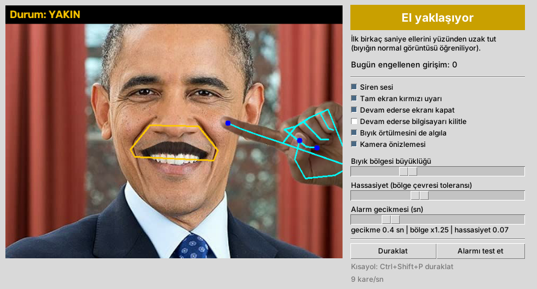
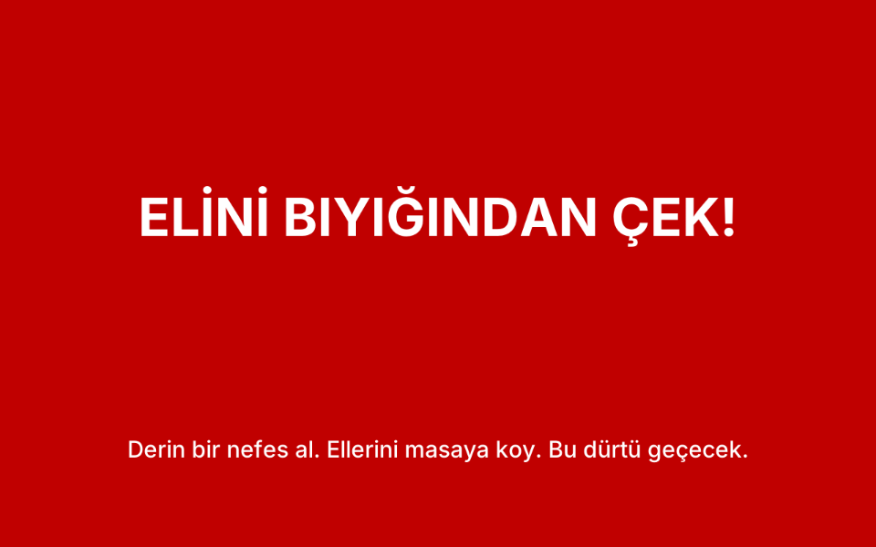
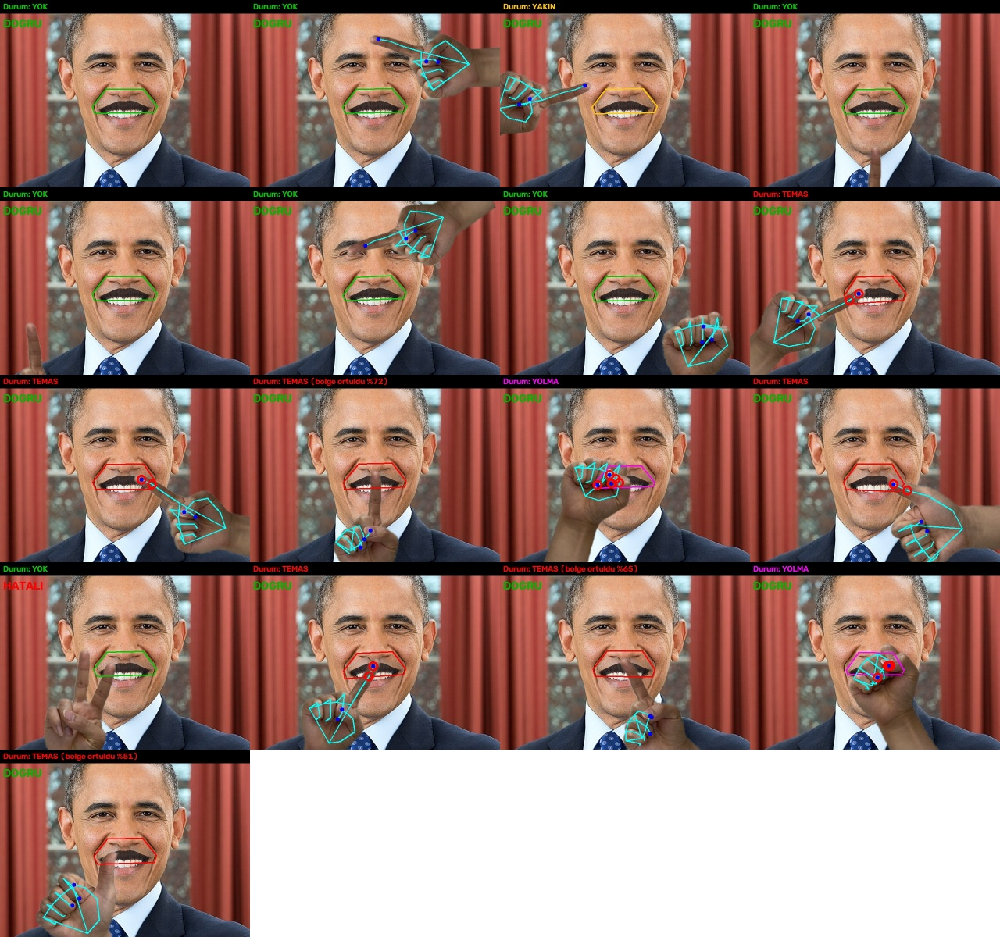

# Trikotillomani Kontrol 🛑✋

Bilgisayar kamerasıyla elinizi izleyen, **parmaklarınız bıyığınıza gittiğinde veya yolma
girişiminde bulunduğunuzda** sizi anında durduran bir Windows uygulaması.

* Elinizi yüzünüzün **başka bir yerine** (yanak, alın, göz, çene) götürmeniz alarm **vermez**.
* Sadece **bıyık bölgesi** (burun altı – üst dudak arası) izlenir.
* Kısa bir dokunuş (kaşıma vb.) alarm vermez; parmak orada **kalırsa** (varsayılan 0,4 sn) veya
  **çimdik/yolma hareketi** yapılırsa (0,1 sn) alarm başlar.

## Alarm olunca ne oluyor?

1. 🔊 **Siren sesi** çalar (döngü hâlinde)
2. 🟥 **Ekranın tamamı** kırmızı-siyah yanıp sönen uyarıyla kaplanır: **“ELİNİ BIYIĞINDAN ÇEK!”**
3. 🖥️ Elinizi 5 saniye içinde çekmezseniz **monitör kapatılır** (isteğe bağlı olarak bilgisayar **kilitlenir**)
4. ✅ Elinizi çektiğiniz anda (1,5 sn sonra) her şey kendiliğinden kapanır
5. 📊 Her girişim `kayitlar.csv` dosyasına kaydedilir, “Bugün engellenen girişim” sayacı gösterilir

| Koruma aktif | Tam ekran uyarı |
|---|---|
|  |  |

---

## Kurulum (Windows)

### Yol A — Hazır .exe (önerilen, Python gerekmez)

1. Bu deponun **Releases** sayfasına girin (sağ tarafta “Releases” → **TrikoKontrol - Windows (son sürüm)**)
   ya da **Actions** sekmesi → son başarılı “Windows .exe derle” çalışması → *Artifacts* bölümü.
2. `TrikoKontrol-Windows.zip` dosyasını indirin ve bir klasöre **çıkartın** (ör. `C:\TrikoKontrol`).
3. `TrikoKontrol.exe` dosyasını çift tıklayın.
   *Windows “bilinmeyen yayımcı” uyarısı verirse:* **Ek bilgi → Yine de çalıştır**.
4. Bilgisayar açılınca otomatik başlasın istiyorsanız `windows_acilista_baslat.bat` dosyasını bir kez çalıştırın.

### Yol B — Python ile

1. [Python 3.12](https://www.python.org/downloads/) kurun (kurulumda **“Add python.exe to PATH”** işaretleyin).
2. Depoyu indirin: yeşil **Code** düğmesi → **Download ZIP** → klasöre çıkartın.
3. `kurulum.bat` dosyasını çift tıklayın (bir kez, birkaç dakika sürer).
4. Her kullanımda `baslat.bat` dosyasını çift tıklayın.

---

## Kullanım ipuçları

* **İlk 2-3 saniye ellerinizi yüzünüzden uzak tutun.** Program bu sırada bıyığınızın normal
  görüntüsünü öğrenir (parmak ucu görünmese bile bıyığın örtüldüğünü anlayabilmek için).
* Kamera yüzünüzü **önden** ve **iyi ışıkta** görmeli. Kamerayı ekranın üstüne, yüz hizasına takın.
* Önizlemede bıyığınızın etrafında bir çokgen görürsünüz:
  🟩 yeşil = güvenli, 🟨 sarı = el yaklaşıyor, 🟥 kırmızı = temas, 🟪 mor = yolma hareketi.
* **Duraklat** düğmesi veya **Ctrl+Shift+P**: yemek yerken / yüzünüzü yıkarken geçici olarak durdurun.
* **Alarmı test et**: sesi ve ekranı 3 saniye dener.
* **Bıyık bölgesi büyüklüğü**: bıyığınız gürse ve çokgen bıyığın tamamını kapsamıyorsa büyütün
  (varsayılan 1.25). Çok büyütmek yanağa dokunuşlarda da alarm verebilir.
* **Hassasiyet**: bölgenin çevresindeki tolerans. Büyütürseniz daha erken uyarır ama yanlış alarm
  artar; önce *bölge büyüklüğünü* ayarlayın, hassasiyeti 0.05-0.10 arasında tutun.
* Önizlemede **gri çizgili el** görürseniz: model yüzünüzün bir kısmını (yanak, kulak) el sanmış,
  program bunu **sahte el** olarak tanıyıp yok saymış demektir; alarm vermez.
* **Alarm gecikmesi**: parmağın bıyıkta ne kadar kalınca alarm çalacağı. 0 yaparsanız anında çalar.
* Önizlemeyi kapatmak işlemciyi biraz rahatlatır; koruma arka planda çalışmaya devam eder.

### Ayarlar dosyası (`ayarlar.json`)

Program ilk açılışta yanına `ayarlar.json` oluşturur. Arayüzde olmayan ayarlar:

| Ayar | Açıklama | Varsayılan |
|---|---|---|
| `kamera_no` | Birden fazla kamera varsa 1, 2… deneyin (harici USB kamera genelde 1) | 0 |
| `biyik_bolgesi` | Bıyık bölgesinin büyüklüğü (arayüzde de var) | 1.25 |
| `yolma_bekleme_sn` | Çimdik/yolma hareketinde alarm gecikmesi | 0.1 |
| `birakma_sn` | El bu kadar süre uzak kalınca alarm kapanır | 1.5 |
| `ust_seviye_sn` | Alarm bu kadar sürerse ekran kapatılır / kilitlenir | 5.0 |
| `ekrani_kilitle` | Üst seviyede Windows'u kilitle | false |
| `ozel_ses_dosyasi` | Kendi `.wav` sesiniz (ör. kendi sesinizle “Dur!” kaydı) | "" |
| `uyari_metni`, `uyari_alt_metni` | Ekranda yazan mesajlar | |

---

## Nasıl çalışıyor?

* **Google MediaPipe** yapay zekâ modelleri (`models/` klasöründe, internet gerekmez):
  * *Face Landmarker* → yüzde 478 nokta → burun altı ile üst dudak arasından **bıyık bölgesi** çıkarılır.
  * *Hand Landmarker* → her elde 21 nokta. Başparmak/işaret/orta parmak uçları bıyık bölgesine
    girerse **TEMAS**, başparmak ile işaret parmağı birbirine yakın ve bıyıktaysa **YOLMA**.
  * Yüze yakın elleri kaçırmamak için yüz çevresine yakınlaştırılmış ikinci bir el taraması yapılır.
* **Sahte el elemesi:** Model bazen yanağı, kulağı veya burnu küçük bir el sanabiliyor (özellikle baş
  yana dönükken). Yüzün üzerinde duran ama avucu yüze göre çok küçük olan, ya da bileği yüzün içinde
  ve dudağın üstünde kalan "eller" yok sayılır. Gerçek bir elin bileği çenenin altında veya yüzün yanındadır.
* **Baş açısı:** Baş belirgin şekilde yana dönükken görüntü değişimine dayalı yedek kontrol kapatılır;
  bıyığın elsiz görüntüsü her baş açısı için ayrı öğrenilir.
* **Yedek kontrol (örtülme):** Parmak ucu kameradan görünmese bile, el bıyığın yanındayken
  bıyık bölgesinin görüntüsü normalden belirgin şekilde değişirse temas sayılır. El yüzü kapatıp
  yüz kaybolursa son bilinen bıyık konumu 3 saniye hatırlanır.
* Görüntüler **hiçbir yere gönderilmez, kaydedilmez**; her şey bilgisayarınızda işlenir.

## Test

Gerçek bir portre fotoğrafına sentetik bıyık çizilip gerçek el fotoğrafları farklı konumlara
yerleştirilerek 17 demo görüntü üretildi (`demo/girdiler`), sonuçlar `demo/sonuclar` klasöründe:



* **7/7 negatif** (el yok, alında, yanakta, çenede, gözde, yüzden uzak, omuzda) → **hiç yanlış alarm yok**
* **9/10 pozitif** (işaret parmağı sol/sağ/orta/eğik, başparmak, yumruk-çimdik) → alarm.
  Kaçırılan tek görüntüde (iki parmak/zafer işareti) yapıştırılan el modele hiç el olarak görünmedi.
* Alarm zamanlaması (kısa dokunuşta alarm yok, süren temasta alarm, el çekilince kapanma, üst seviye)
  ve video akışı testleri geçti.
* Kullanıcı geri bildirimi testleri (v1.1): yanakta ve kulakta hayali el → alarm yok; baş yana
  dönükken → alarm yok; bıyık bölgesi çizilen bıyığın %99'unu kapsıyor (eskisi %92).

```bash
python tests/make_demo_images.py   # demo görüntüleri üret
python tests/test_detector.py      # testleri çalıştır, sonuçları demo/sonuclar'a yaz
python tests/make_demo_video.py    # demo video üret
python baslat.py --video demo/demo_video.mp4   # uygulamayı kamera yerine demo videoyla dene
python baslat.py --resim foto.jpg --cikti sonuc.jpg  # tek fotoğrafta dene
```

> Demo görüntüler gerçek bir webcam kaydı değil, birleştirilmiş fotoğraflardır. Kendi kameranızla
> ilk gün hassasiyet ve gecikme ayarlarını kendinize göre düzenlemeniz gerekebilir.

## Sorun giderme

* **“Kamera açılamadı”** → Kamera başka bir programda (Zoom, Teams, Kamera uygulaması) açık olabilir;
  kapatın. Harici kamera kullanıyorsanız `ayarlar.json` içinde `"kamera_no": 1` yapın.
* **Alarm geç çalıyor / hiç çalmıyor** → Işığı artırın, kamerayı yüz hizasına alın, hassasiyeti büyütün.
* **Gereksiz alarm** (ör. yemek yerken) → Duraklat (Ctrl+Shift+P) veya alarm gecikmesini artırın.
* **Ekran kapanmıyor** → Bazı monitör/sürücüler bu komutu desteklemez; `ekrani_kilitle` ayarını açabilirsiniz.
* Hata ayrıntıları `hata_kaydi.txt` dosyasına yazılır.

---

💙 *Bu uygulama bir yardımcı araçtır, tedavinin yerine geçmez. Trikotillomanide en etkili
yöntemlerden biri olan **Alışkanlık Tersine Çevirme Eğitimi (HRT)** ile birlikte kullanılabilir:
alarm çaldığında ellerinizi yumruk yapıp 1 dakika masaya bastırmak gibi bir “karşıt hareket”
belirleyin. Bir psikiyatrist veya psikologdan destek almak süreci çok kolaylaştırır.*
